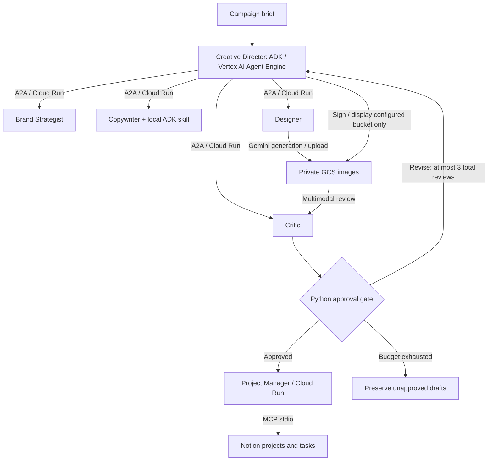

# Architecture and execution flow

The existing Google ADK/A2A architecture is preserved. `creative_director/agent.py` retains the Creative Director factory, quality-gate callbacks and five remote specialist registrations. Each configured specialist is wrapped in `ReliableRemoteAgent`, which extends ADK's `RemoteA2aAgent` to preserve error-only events and convert remote execution exceptions into structured error responses.

The active session-state guards and response validation are implemented in `agent.py`. The adjacent `reliability.py` also contains legacy specialist lifecycle helpers that are not currently invoked by the Creative Director.

## Data and authorization
`start_campaign` accepts a nonempty name and initializes gate state once. Another campaign needs a
new ADK session. Standalone research/content remains possible without initialization; campaign Critic
and PM calls require an active campaign. The model passes the brief and prior outputs in specialist
requests; Python guards decide whether the requested operation may execute.

Critic parsing requires exactly one POSTS REVIEW, VISUALS REVIEW and OVERALL ASSESSMENT section,
exactly one valid status field in each relevant section, and APPROVED/APPROVED/YES. CRLF responses
remain supported. Scores alone never authorize PM. Three total reviews are allowed, counting returned
failed reviews conservatively. Calls blocked before execution do not consume reviews. Research/copy/
design/review calls revoke previous approval. The Creative Director uses a `critic_in_progress` session marker.
When a Critic review begins, subsequent Critic, Copywriter and Designer calls are blocked until the review completes
or a handled error response releases the marker. This does not serialize every specialist operation. The marker is
not an atomic or distributed lock, and exception paths outside the handled callback lifecycle may still require recovery.

## A2A response boundary
Installed ADK 1.31.1 AgentTool merges non-thought text from the last content Event for these schema-less
agents. Error-only Events would otherwise disappear. ReliableRemoteAgent turns them into text JSON
containing the actual error; the callback normalizes that error and blocks further specialist work.
Normal nonempty prose and JSON deliverable text are accepted; legacy result envelopes remain supported.
Unknown Python types/missing results/explicit failures are rejected. This validates transport shape,
not whether research is truthful or captions/images satisfy every brief requirement.

ADK invokes after callbacks even for before-callback blocks. Internal guard results carry a marker so
they do not overwrite the original failure, consume reviews or replace completed outputs.

## Session state and recovery

| Key | Meaning |
|---|---|
| `active_campaign` | Current initialized campaign |
| `quality_gate_rounds` / approval / exhaustion state | Review count, approval status and three-review limit |
| `critic_in_progress` | Critic execution marker |
| `specialist_failure` | Recorded specialist error and failure latch |
| `completed_outputs` | Successful specialist results |
| `completed_requests` | Completed request values used by replay guards |
| `image_operations` | Designer-side image operation cache, as documented |
| `notion_write_attempts` | PM-side Notion write safeguards, as documented |

PM failure leaves approved creative outputs intact; Notion failure may still yield a valid text
timeline. Uploaded GCS images remain successful if optional artifact saving fails. Link failures do
not trigger generation. Sessions and artifacts contain user data: restrict access and retention.

AgentTool creates a child session; remote A2A session persistence is not guaranteed by these local
safeguards. Separate processes, restarts or changed arguments can bypass cache-based deduplication.
After uncertainty, query existing objects/pages with approval before recovering. There is no automatic
reset/replay tool and no durable exactly-once claim.

## Retries and observability
Existing reasoning retries use SDK exponential backoff with jitter (Director five attempts; some
specialists three). Image generation uses one attempt; A2A/Notion writes have no added retry loop.
Timeouts are not transaction rollback. The project includes logging and error reporting, but the
specialist latency metrics implemented in the unused `finish_specialist()` helper are not currently
collected through the active Creative Director callbacks. Production latency, error-rate and cost
monitoring require separate verification. Full `LoggingPlugin` instrumentation is disabled.
Metadata-only failure logs omit raw error contents.
Upstream SDK/transport logs still need review.
